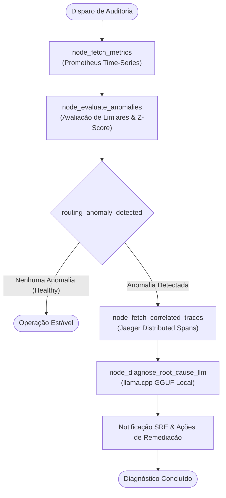

# Detector de Anomalias de Telemetria com Agentes Autônomos

<div align="center">


<p>Agente autônomo baseado em <b>LangGraph</b> e <b>llama.cpp</b> (GGUF local) para consumo de métricas de telemetria, correlação de traces distribuídos e diagnóstico inteligente de causa raiz para SRE.</p>

</div>

---

## 🏗️ Topologia do Agente Autônomo (LangGraph)



---

## 🏛️ Clean Architecture: Estrutura em Camadas

### 1. Ordem de Escrita (de dentro pra fora)

| Ordem | Camada | Arquivo(s) | Por quê essa ordem |
|---|---|---|---|
| 1 | Domínio / Enums & Entidades | `app/core/domain/enum/anomaly_severity.py`<br/>`app/core/domain/models/telemetry.py` | Entidades de métricas, spans de trace e diagnóstico de causa raiz desacopladas de qualquer SDK. |
| 2 | Domínio / Portas & Gateways | `app/core/domain/gateway/prometheus_gateway.py`<br/>`app/core/domain/gateway/jaeger_gateway.py`<br/>`app/core/domain/gateway/local_llm_gateway.py`<br/>`app/core/domain/gateway/incident_notifier_gateway.py` | Contratos abstratos para obtenção de séries temporais, traces distribuídos e inferência local LLM. |
| 3 | Aplicação / Grafo & Agentes | `app/core/usecase/anomaly_agent/state.py`<br/>`app/core/usecase/anomaly_agent/nodes.py`<br/>`app/core/usecase/anomaly_agent/edges.py`<br/>`app/core/usecase/anomaly_agent/graph.py`<br/>`app/core/usecase/diagnose_infrastructure_usecase.py` | Orquestra a máquina de estados do agente autônomo através das interfaces de domínio. |
| 4 | Infraestrutura / Adaptadores Concretos | `app/infrastructure/gateway/prometheus_client_impl.py`<br/>`app/infrastructure/gateway/jaeger_trace_client_impl.py`<br/>`app/infrastructure/gateway/llama_cpp_client_impl.py`<br/>`app/infrastructure/gateway/incident_notifier_impl.py`<br/>`app/infrastructure/config/settings.py` | Conectores HTTP para a API PromQL do Prometheus, Jaeger Query e execução de modelos GGUF com llama.cpp. |
| 5 | Apresentação / API & CLI | `app/presentation/dtos/telemetry_dto.py`<br/>`app/presentation/api/v1/controllers/telemetry_controller.py`<br/>`app/presentation/api/v1/router.py`<br/>`app/presentation/cli/diagnose_cli.py`<br/>`main.py` | Ponto de entrada RESTful FastAPI e ferramenta CLI para diagnósticos instantâneos no terminal. |

### 2. Ordem de Leitura (de fora pra dentro)

| Ordem | Pergunta que você está respondendo | Arquivo(s) |
|---|---|---|
| 1 | Como interagir via terminal ou acionar o agente? | `app/presentation/cli/diagnose_cli.py` ou `app/presentation/api/v1/router.py` |
| 2 | O que o controlador valida e delega? | `app/presentation/api/v1/controllers/telemetry_controller.py` |
| 3 | O que o caso de uso manda o agente executar? | `app/core/usecase/diagnose_infrastructure_usecase.py` |
| 4 | Qual a topologia de decisão do LangGraph? | `app/core/usecase/anomaly_agent/graph.py` |
| 5 | Quais dados compõem métricas e causas raiz? | `app/core/domain/models/telemetry.py` |
| 6 | Como os clientes Prometheus, Jaeger e llama.cpp operam? | `app/infrastructure/gateway/*` |

---

## 🐳 Execução via Docker Compose

```bash
# Iniciar Agente, Prometheus, Jaeger e OpenTelemetry Collector
docker compose up --build -d

# Visualizar logs do agente
docker compose logs -f agent-service
```

### Portas e Serviços:
- **FastAPI Telemetry Agent:** [http://localhost:8000](http://localhost:8000)
- **Documentação Interativa Swagger:** [http://localhost:8000/docs](http://localhost:8000/docs)
- **Painel Prometheus:** [http://localhost:9090](http://localhost:9090)
- **Jaeger Distributed Tracing UI:** [http://localhost:16686](http://localhost:16686)

---

## 💻 Diagnóstico Rápido via CLI

Você pode executar o agente diretamente pela linha de comando para inspecionar um serviço específico:

```bash
python -m app.presentation.cli.diagnose_cli checkout-service
```

---

## 🧪 Executando Testes Automatizados

```bash
python -m venv .venv
source .venv/bin/activate
pip install -r requirements.txt
pytest tests/ -v
```

---

## 📄 Licença

Distribuído sob a licença MIT. Consulte `LICENSE` para mais detalhes.
